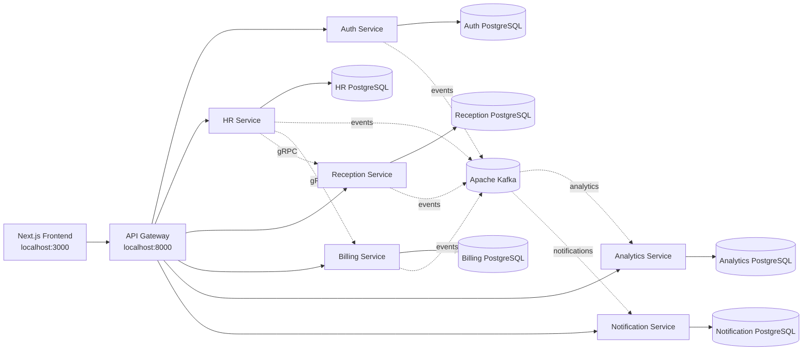

# Hospital Management System

## Technologies

[](https://openjdk.org/)
[](https://spring.io/projects/spring-boot)
[](https://gradle.org/)
[](https://nextjs.org/)
[](https://react.dev/)
[](https://www.typescriptlang.org/)
[](https://tailwindcss.com/)
[](https://www.postgresql.org/)
[](https://kafka.apache.org/)
[](https://www.docker.com/)
[](https://github.com/features/actions)

**Frontend:** Next.js, React, TypeScript, Tailwind CSS, shadcn/ui, TanStack
React Query, and Orval  
**Backend:** Java, Spring Boot, Spring Security, Spring Data JPA, MapStruct,
and Lombok  
**Services:** Auth, HR, Reception, Billing, Analytics, and Notifications  
**Communication:** REST, gRPC, and Apache Kafka  
**Databases:** PostgreSQL  
**Infrastructure:** Docker Compose, Gradle, and GitHub Actions

## Overview

The Hospital Management System is a modular application for managing hospital
operations. It provides authenticated workflows for employees, doctors,
reception staff, HR teams, billing users, and administrators.

The backend is organized as independent Spring Boot services. Each service owns
its domain and database, while the API Gateway provides a single HTTP entry
point for the frontend. Kafka is used for asynchronous events such as analytics
and notifications, and the HR service exposes gRPC operations used by billing
and reception.

## Architecture



### Main components

- **API Gateway:** Routes frontend requests to backend services.
- **Auth Service:** Handles users, roles, JWT authentication, and authorization.
- **HR Service:** Manages employees, physicians, departments, schedules, leave,
  attendance, and payroll.
- **Reception Service:** Manages patients, reservations, queues, admissions,
  prescriptions, and schedules.
- **Billing Service:** Manages invoices, payments, insurance, cash desks, and
  service tariffs.
- **Analytics Service:** Consumes domain events and provides analytics data.
- **Notification Service:** Stores and serves authenticated user notifications.
- **Frontend:** Provides the browser-based hospital operations interface.

Each backend service has its own PostgreSQL database. The databases are not
shared directly between services; cross-service data is accessed through
service APIs or gRPC.

## Prerequisites

- Docker and Docker Compose
- Node.js 22 or newer
- npm
- Java 21 (only required for running backend services outside Docker)

## Running with Docker Compose

From the repository root, build and start the backend infrastructure and
services:

```bash
docker compose up --build
```

The API Gateway is available at:

```text
http://localhost:8000
```

To stop the containers:

```bash
docker compose down
```

To stop the containers and remove persisted database volumes:

```bash
docker compose down -v
```

The `-v` option deletes local development data and should only be used when a
fresh database is required.

## Running the frontend

Start the backend with Docker Compose first, then open a second terminal:

```bash
cd frontend
npm install
npm run dev
```

Open the frontend at:

```text
http://localhost:3000
```

The frontend communicates with the API Gateway at `http://localhost:8000`.

## Development checks

Backend checks are run from the individual service directories:

```bash
cd auth-service
./gradlew spotlessCheck test
```

Replace `auth-service` with the service being changed. Frontend checks are:

```bash
cd frontend
npm run format:check
npm run lint
npx tsc --noEmit
```

GitHub Actions uses path-based change detection so only the services affected
by a commit are linted and tested.
